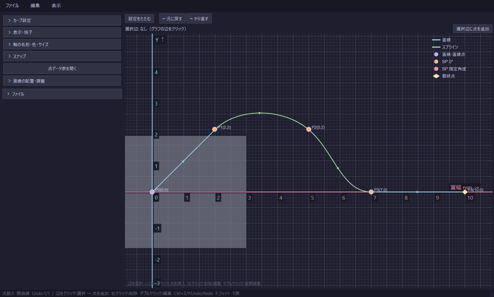

# CurveEditor_rev5

CurveEditor_rev5 is a 2D editor for points and straight-line or spline segments. It includes Python source and sample files.

## Download

**Version 2.3.0**

- [Japanese edition](https://github.com/Kawasemi-Engineering-lab/CurveEditor_rev5/releases/download/v2.3.0/CurveEditor_rev5_2.3.0.zip)
- [English edition](https://github.com/Kawasemi-Engineering-lab/CurveEditor_rev5/releases/download/v2.3.0/CurveEditor_rev5_2.3.0_EN.zip)

Both ZIP files include the Python source and samples. Install Python and the libraries listed in the included `requirements.txt` before running the application.

## Features

- Edit points and choose straight or spline segments
- Constrain connection angles and straight-line lengths
- Lock segments and trace background images
- Undo and redo
- Save projects and export shape definitions or XY points as CSV/TXT

## Download terms

The packages are free to download. No license granting redistribution or modification is included.
